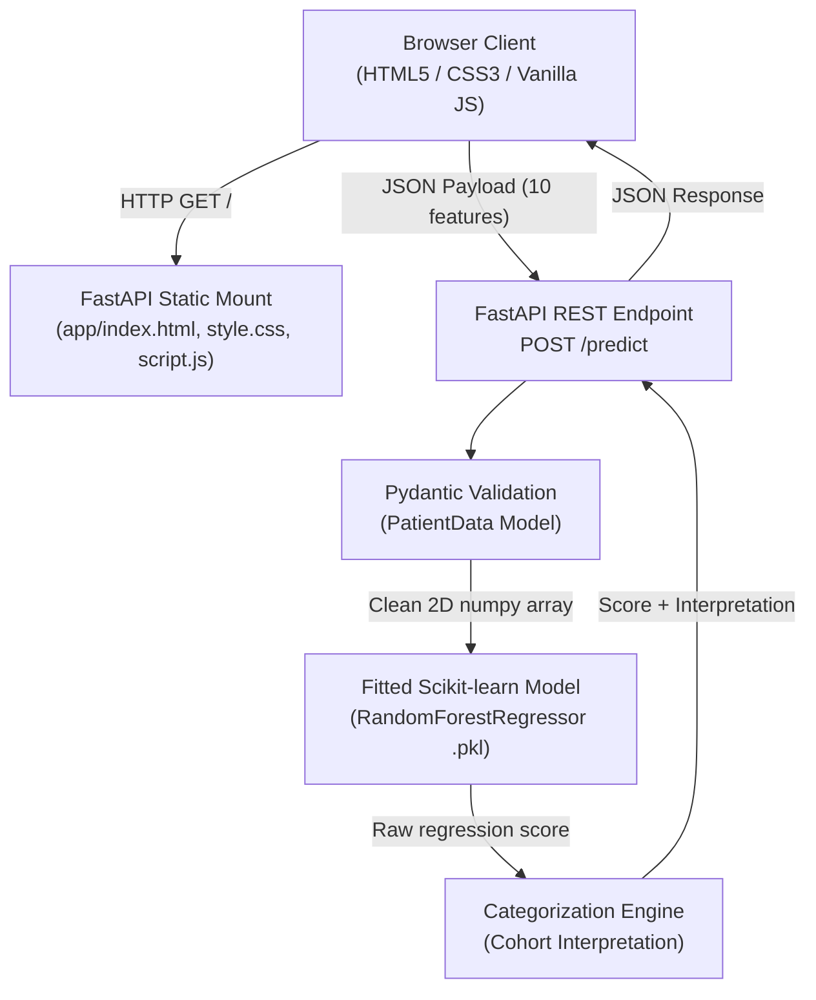

# 🩺 Diabetes Progression Predictor

An end-to-end Machine Learning web application designed to predict a quantitative measure of disease progression one year post-baseline for diabetic patients based on 10 physiological and serum metrics. Built using **FastAPI**, **Scikit-learn**, vanilla modern **HTML5/CSS3/JavaScript**, and fully containerized with **Docker** and automated via **GitHub Actions CI/CD**.

---

## 📑 Table of Contents
1. [Project Overview](#-project-overview)
2. [Clinical & Dataset Context](#-clinical--dataset-context)
3. [System Architecture](#-system-architecture)
4. [Machine Learning Pipeline](#-machine-learning-pipeline)
5. [API Specification](#-api-specification)
6. [Frontend UI & Design System](#-frontend-ui--design-system)
7. [Repository Structure](#-repository-structure)
8. [Installation & Local Setup](#-installation--local-setup)
9. [Running with Docker](#-running-with-docker)
10. [Automated Testing & CI/CD](#-automated-testing--cicd)
11. [Clinical Deployment & Limitations](#-clinical-deployment--limitations)
12. [License & Acknowledgements](#-license--acknowledgements)

---

## 🔬 Project Overview

The **Diabetes Progression Predictor** is a production-grade machine learning system providing both a high-performance RESTful API and a lightweight, dependency-free frontend client. 

### Key Highlights:
- **FastAPI Core**: Asynchronous API server with automatic OpenAPI/Swagger documentation, CORS compliance, and Pydantic validation.
- **Pure Web Stack Client**: Custom HTML5, modern CSS3 with custom variables (design tokens), and JavaScript without external runtime dependencies (no React or heavy frameworks required).
- **Interactive Progression Scale**: Dynamic reference bar positioning predictions within statistical cohort quartiles ($25$ to $346$).
- **Dark/Light Mode**: First-class support with zero layout shift, system preference detection (`prefers-color-scheme`), and persistent `localStorage` state.
- **Production DevOps**: Multi-stage lightweight `python:3.11-slim` Docker image, Docker Compose orchestration, health checks, and a complete GitHub Actions CI pipeline running unit/API regression tests.

---

## 📊 Clinical & Dataset Context

This application utilizes the benchmark **Diabetes Dataset** originally documented by *Bradley Efron, Trevor Hastie, Iain Johnstone, and Robert Tibshirani (2004)* in *"Least Angle Regression" (Annals of Statistics)* and bundled in Scikit-learn (`sklearn.datasets.load_diabetes`).

### What the Target Represents:
- **Baseline Population**: 442 diabetic individuals ($n=442$).
- **Predicted Variable ($y$)**: A continuous, quantitative composite measure of disease progression recorded **one year after baseline examinations**.
- **Crucial Clarification**: This is **not** a binary classification model (it does not diagnose whether someone is diabetic or healthy; every participant in the cohort was already diagnosed with diabetes). It measures relative trajectory and acceleration of the disease.

### Statistical Distribution of the Progression Score:
| Metric | Value |
| :--- | :--- |
| **Minimum** | $25.0$ |
| **First Quartile ($Q_1$)** | $87.0$ |
| **Median ($50^{\text{th}}$ Percentile)** | $140.5$ |
| **Mean ($\mu$)** | $152.1$ |
| **Standard Deviation ($\sigma$)** | $77.1$ |
| **Third Quartile ($Q_3$)** | $211.5$ |
| **Maximum** | $346.0$ |

### Input Features (Standardized):
All ten baseline variables were mean-centered and scaled by the standard deviation times the square root of $n$:
1. `age`: Age in years (standardized)
2. `sex`: Biological sex (coded numerically and scaled)
3. `bmi`: Body Mass Index ($\text{kg/m}^2$, standardized)
4. `bp`: Mean arterial blood pressure (standardized)
5. `s1` (`tc`): Total serum cholesterol (standardized)
6. `s2` (`ldl`): Low-density lipoproteins ("bad" cholesterol, standardized)
7. `s3` (`hdl`): High-density lipoproteins ("good" cholesterol, standardized)
8. `s4` (`tch`): Total cholesterol / HDL ratio (standardized)
9. `s5` (`ltg`): Log of serum triglycerides level (standardized)
10. `s6` (`glu`): Blood glucose level (standardized)

---

## 🏗️ System Architecture



---

## 🤖 Machine Learning Pipeline

The offline training process is automated via [`train_model.py`](train_model.py):

- **Algorithm**: `RandomForestRegressor`
  - `n_estimators`: `100`
  - `max_depth`: `10`
  - `random_state`: `42`
- **Data Splitting**: 80% train ($n=353$), 20% test ($n=89$) stratified by random seed.
- **Model Serialization**: Exported using `pickle` to [`models/diabetes_model.pkl`](models/diabetes_model.pkl).
- **Test Performance**:
  - $R^2 \text{ Score}$: $\approx 0.44 - 0.47$
  - $\text{Mean Squared Error (MSE)}$: $\approx 2900 - 3000$
  - $\text{Mean Absolute Error (MAE)}$: $\approx 42 - 44$

---

## 🔌 API Specification

The backend server is powered by FastAPI and listens on port `8000`.

### Endpoints

#### 1. Root & Web Client
- **`GET /`**
  - **Description**: Serves the user interface ([`index.html`](app/index.html)).
  - **Response**: `200 OK` (`text/html`).

#### 2. Health Check
- **`GET /health`**
  - **Description**: Heartbeat check used by Docker health checks and monitoring proxies.
  - **Response**:
    ```json
    {
      "status": "healthy",
      "model": "diabetes_progression_v1"
    }
    ```

#### 3. Disease Progression Prediction
- **`POST /predict`**
  - **Description**: Computes predicted disease progression score.
  - **Request Body** (`application/json`):
    ```json
    {
      "age": 0.05,
      "sex": 0.05,
      "bmi": 0.06,
      "bp": 0.02,
      "s1": -0.04,
      "s2": -0.04,
      "s3": -0.02,
      "s4": -0.01,
      "s5": 0.01,
      "s6": 0.02
    }
    ```
  - **Response** (`200 OK`):
    ```json
    {
      "predicted_progression_socre": 204.62,
      "interpretation": "Above average progression"
    }
    ```
  - **Error Response** (`422 Unprocessable Entity`): Returned when required inputs are omitted or invalid data types are supplied.

Interactive Swagger/OpenAPI documentation is available at `http://localhost:8000/docs`.

---

## 🎨 Frontend UI & Design System

The client is engineered with design fidelity and usability:
- **Typography**: Inter via Google Fonts with system fallback stack (`-apple-system`, `BlinkMacSystemFont`, `Segoe UI`).
- **Color Tokens**:
  - Primary Teal: `#0f766e` (Light) / `#14b8a6` (Dark)
  - Surface Background: `#edf2f2` (Light) / `#0f172a` (Dark)
  - Card Containers: `#ffffff` (Light) / `#1e293b` (Dark)
- **Visual Progression Scale**:
  - Continuous CSS linear gradient bar from `#22c55e` (green) $\rightarrow$ `#fbbf24` (amber) $\rightarrow$ `#ef4444` (red).
  - Ticks corresponding to benchmark values: **25**, **100**, **150**, and **346**.
  - Dynamic marker with an animated position indicator and numeric pill label that calculates:
    $$\text{Position (\%)} = \left(\frac{\text{Score} - 25}{346 - 25}\right) \times 100$$
- **Variable Guide Tab**: Complete reference tab detailing clinical background for every serum and physiological measurement.

---

## 📁 Repository Structure

```text
diabetes-predictor/
├── .github/
│   └── workflows/
│       └── ci.yml               # GitHub Actions CI workflow definition
├── app/
│   ├── index.html               # Main frontend interface & variable guide
│   ├── style.css                # CSS styles, design tokens, light/dark mode
│   ├── script.js                # Form handler, theme toggle, API integration
│   ├── main.py                  # FastAPI application, static routes & endpoints
│   └── schema.py                # Pydantic input validation model
├── models/
│   └── diabetes_model.pkl       # Serialized Random Forest regression model
├── tests/
│   ├── __init__.py
│   └── test_main.py             # Pytest suite for API endpoints & business logic
├── .dockerignore                # Patterns excluded from Docker build context
├── .gitignore                   # Version control ignore list
├── docker-compose.yml           # Multi-container/orchestration configuration
├── Dockerfile                   # Production Python 3.11 container definition
├── requirements_clean.txt       # Core production dependencies
├── requirements-test.txt        # Automated testing dependencies (pytest, httpx)
├── train_model.py               # Model training and artifact generation script
└── README.md                    # System documentation
```

---

## 💻 Installation & Local Setup

### Prerequisites
- Python 3.11+
- Git

### 1. Clone the Repository
```powershell
git clone <repository_url>
cd diabetes-predictor/diabetes-predictor
```

### 2. Create and Activate Virtual Environment
```powershell
# Windows
python -m venv venv
venv\Scripts\activate

# macOS / Linux
python3 -m venv venv
source venv/bin/activate
```

### 3. Install Dependencies
```powershell
pip install --upgrade pip
pip install -r requirements_clean.txt
pip install -r requirements-test.txt
```

### 4. Run the Application
Start the Uvicorn server:
```powershell
uvicorn app.main:app --reload --port 8000
```
Open **`http://localhost:8000`** in your browser. The application will serve the frontend and route predictions directly to the underlying model.

---

## 🐳 Running with Docker

### Option 1: Docker Compose (Recommended)
Build and launch the container in detached mode:
```powershell
docker compose up --build -d
```
To stop the application:
```powershell
docker compose down
```

### Option 2: Docker CLI
```powershell
# 1. Build the Docker image
docker build -t diabetes-predictor:latest .

# 2. Run container with port forwarding
docker run -d -p 8000:8000 --name diabetes-predictor-app diabetes-predictor:latest
```

The container includes a built-in healthcheck executing:
```sh
curl -f http://localhost:8000/health || exit 1
```

---

## 🧪 Automated Testing & CI/CD

### Local Test Execution
Run the full test suite with verbose output:
```powershell
pytest -v
```

The test suite in [`tests/test_main.py`](tests/test_main.py) validates:
1. `test_health_endpoint`: Asserts HTTP 200 and healthy status payload.
2. `test_homepage_serves_html`: Asserts root route returns HTML document.
3. `test_predict_success`: Sends a valid 10-feature vector and verifies schema and score ranges.
4. `test_predict_invalid_payload`: Confirms validation failure (HTTP 422) on missing/invalid input.
5. `test_interpretation_logic`: Validates the threshold categorization engine.

### Continuous Integration Pipeline
The `.github/workflows/ci.yml` file defines automated checks triggered on all `push` and `pull_request` events to `main`/`master`:
- **Job 1 (`test`)**: Sets up Python 3.11, caches dependencies, installs testing requirements, and executes `pytest`.
- **Job 2 (`docker-build`)**: Verifies that the Docker container builds without errors.

---

## ⚠️ Clinical Deployment & Limitations

> **CRITICAL MEDICAL DISCLAIMER**:  
> This software is strictly an **educational demonstration** and technical portfolio piece. It is **not** certified, validated, or approved for clinical diagnostic or therapeutic purposes.

### Limitations for Real-World Clinical Use:
1. **Model Accuracy ($R^2 \approx 0.45$)**: The regression model accounts for less than half the variance observed in disease progression. The margin of error ($\text{MAE} \approx 43$) is too wide for individual clinical decision-making.
2. **Dataset Size ($n=442$)**: Modern clinical predictive models require thousands to hundreds of thousands of longitudinal observations across diverse patient demographics to prevent geographic, ethnic, or demographic sampling bias.
3. **Normalized Input Constraint**: The model operates exclusively on pre-standardized inputs (zero-mean, unit-variance). In clinical settings, practitioners input raw physiological values ($\text{mg/dL}$, $\text{mmHg}$, $\text{kg/m}^2$). Real deployment would require persistent pipeline transformers (such as `scikit-learn` `ColumnTransformer` or `StandardScaler` artifacts) to map raw inputs to scaled values.

---

## 📄 License & Acknowledgements

- **Dataset**: Efron, Hastie, Johnstone, Tibshirani (2004), *"Least Angle Regression"*.
- **Frameworks**: [FastAPI](https://fastapi.tiangolo.com/), [Scikit-learn](https://scikit-learn.org/), [Uvicorn](https://www.uvicorn.org/).
